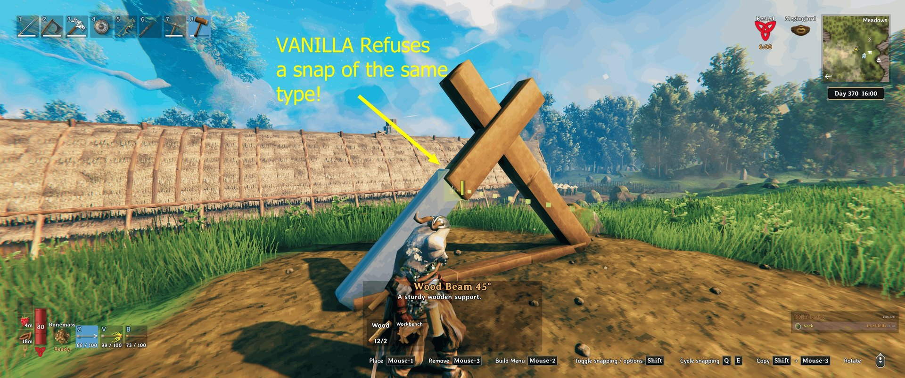
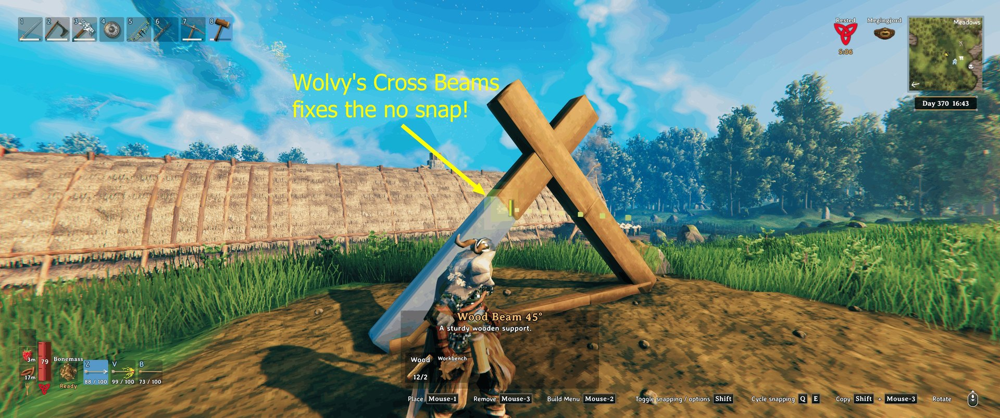

# Wolvy's Cross Beams - Snapping Fix for X Beams

*By Wolvyreen(With_ClaudeAI)*

Ever tried to brace a wall with two angled beams in an X? The first one goes on fine. The second one just won't snap. It hangs in front of the first beam no matter how you aim it or which snap point you pick with Q/E.

This mod fixes that. Put up your first 26° or 45° beam, then snap a second beam of the same kind across it, and it clicks into place like it should.

## Why the game won't let you

Valheim has a little safety check to stop you double-clicking and dropping a second piece hidden inside the first one. If the same piece is already sitting within 5 cm of where the new one would go, the game cancels the snap.

The trouble is that it only looks at where the middle of the piece is, not which way it's facing. In a neat X, both beams have their middle in exactly the same spot, so the game thinks your second beam is a copy of the first and quietly refuses it.

## What I changed

Instead of comparing the middle of the pieces, the mod compares their snap points (the ends and corners things attach to).

A beam crossing another one has its ends somewhere else, so it snaps. A real duplicate has its ends on top of the old one's, so it's still blocked. That includes the sneaky ones that look different on paper but sit exactly the same in the world, like a beam turned all the way round, a pole turned any amount, or a square floor turned a quarter turn.

The only extra thing it now allows is a square floor turned 45° in the same spot as another floor. You'd see that one straight away because the corners stick out, so it can't hide.

Nothing else is touched. Placement rules, support, costs, workbench range and wards all work exactly like vanilla, and what you build is just normal vanilla pieces.

## A few things worth knowing

It's client-side only. Install it on your own game. Servers and friends don't need it, and they'll see your crosses just fine.

You can take it out any time. Everything you built stays where it is. You just lose the easier snapping.

If a Valheim update changes the bit of game code this mod hooks into, it writes a note to the BepInEx log and switches itself off, so you're back to normal vanilla snapping rather than anything breaking.

## Settings

There's one setting, and the easiest place to change it is in game: open your inventory (Tab) and click the wolf's head button. That opens "Wolvy's Mods", one window with a tab for each of my mods you have installed. Cross Beams has its own tab there.

`Enabled` (on by default) turns the fix off without uninstalling the mod.

You can also change it in Configuration Manager if you use it, or in `BepInEx/config/wolvy.valheim.crossbeams.cfg` (it appears after you start the game once with the mod).

## Installing

Download it from [Thunderstore](https://thunderstore.io/c/valheim/p/Wolvyreen/Wolvys_Cross_Beams/) or [Nexus Mods](https://www.nexusmods.com/valheim/mods/4876).

**r2modman or Thunderstore Mod Manager:** hit Install and you're done. It sets up BepInEx for you if you don't have it.

**Vortex or Mod Organizer 2:** use "Mod Manager Download" on the Nexus page and enable the mod. You'll need BepInEx for Valheim set up in your mod manager first. Vortex's Valheim support does this for you. In Mod Organizer 2, use its Valheim support plugin and install BepInExPack Valheim as a mod.

**By hand:** install [BepInExPack Valheim](https://thunderstore.io/c/valheim/p/denikson/BepInExPack_Valheim/), then drop `WolvysCrossBeams.dll` into `BepInEx/plugins/`. The Nexus download already has the folders set up, so you can just extract it into your Valheim folder (the one with valheim.exe).

## Other mods

It hooks one game method (`Player.IsOverlappingOtherPiece`) with a Harmony prefix.

Mods that add extra snap points, like Extra Snap Points Made Easy or Snapheim, should work fine alongside it. They decide where things can snap, and this one only decides whether a crossing snap is allowed. Mods that add their own rules to the same check after it runs (ItemDrawers Remake and Elite Building Pieces do this) keep working too.

If you find a mod it doesn't get along with, let me know and I'll have a look.

## Source code

Everything's on GitHub, including the tests and build scripts: https://github.com/wolvyreen/Valheim/tree/main/WolvysCrossBeams (MIT licence). Bug reports are welcome there under Issues.

## Thanks

Thanks to the BepInEx team for ScriptEngine. Being able to reload the mod without restarting Valheim made testing this so much quicker. And thanks to denikson for BepInExPack Valheim, which every Valheim mod relies on.

## How this was made

I made this mod with Claude, Anthropic's AI. I ran into the problem while building, worked out what I wanted and tested it in game. Claude dug through the game code to find out why the snap was being refused, and wrote the code and most of the text.

## Changelog

**1.0.2:** The Wolvy's Mods window got some love. You can now move it, resize it and close it with the X in the corner, and the settings line up neatly however big you make it. Snapping works exactly the same as before.

**1.0.1:** The setting now lives in the "Wolvy's Mods" window too, behind the wolf's head button in your inventory. Snapping works exactly the same as before.

**1.0.0:** First release.
