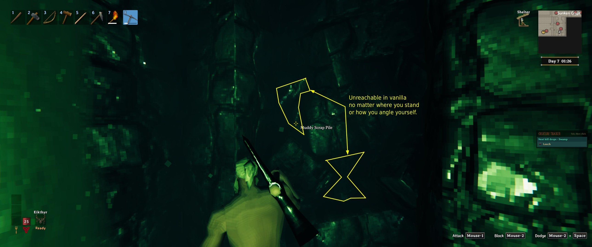
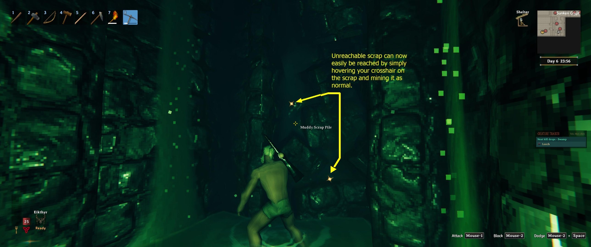
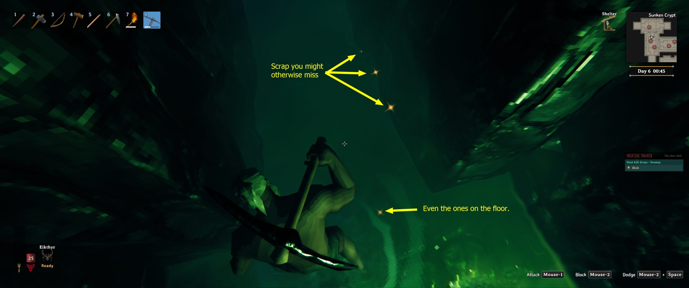
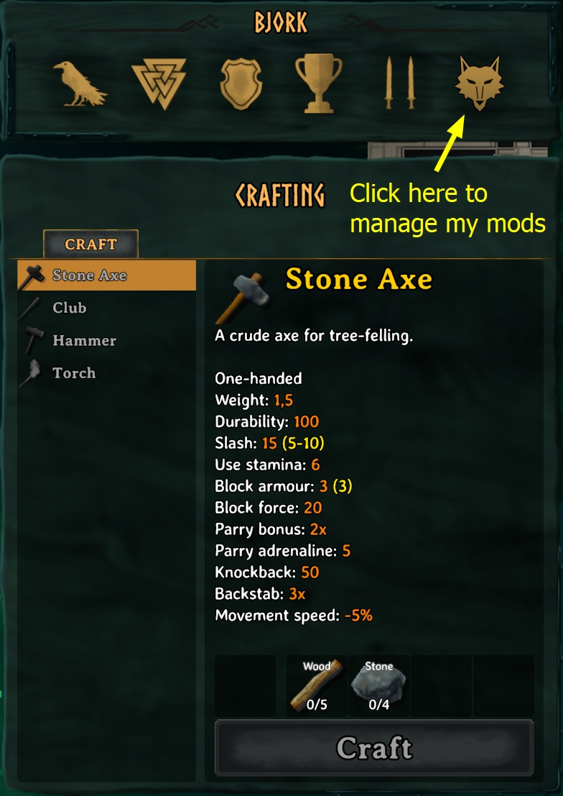

# Wolvy's Unreachable Scrap - Mine Stuck Scrap in Sunken Crypts

*By Wolvyreen(With_ClaudeAI)*

You know the muddy scrap piles in the Sunken Crypts that are half stuck in the black jagged blocks, or sunk into the floor? You can see the scrap, the "Muddy Scrap Pile" name even pops up when you point at it, but every swing just clangs off the rock in front of it. No matter where you stand or how you angle yourself, you can't get it.

This mod lets you mine those bits. Point your crosshair at the scrap and swing like normal.

## What it does

**Reach the stuck scrap.** When your pickaxe swing lands on one of the crypt's jagged blocks (or the crypt floor) and your crosshair is on a bit of muddy scrap right behind it, the hit goes to the scrap instead of the rock. The game then breaks it the normal way, with the normal damage, tool tier and loot.

**Loot lands at your feet.** Scrap that's buried in rock likes to drop its loot inside the rock, where it falls out of the dungeon and is gone. For those bits only, the loot now drops at your feet. Every other drop lands exactly where the game puts it.

**See where stuck scrap is.** While you've got a pickaxe in your hand, stuck scrap you can reach gets a little orange glint now and then, even the slivers in the floor. It's handy for spotting pieces you'd otherwise walk right past. If you'd rather have a soft glow, you can switch to that, and you can change the colour, brightness, speed and how close you need to be.

## Made to feel like normal mining

I wanted this mod to stay out of your way as much as possible, so mining stuck scrap feels just like mining any other scrap and not like cheating. There's no new key, nothing to switch on and nothing to aim differently. You point, you swing, and the scrap breaks the way the game would break it if the rock weren't in the way, with the same damage, tool tier and loot. It doesn't reach through walls or touch scrap you can't see, and the glint is small and only shows while you're holding a pickaxe. I'm happy with how it turned out: in the crypt it just feels like the game working the way it should.

## Why it happens

Your crosshair is a line from the camera, so it can see the scrap. Your swing starts at your character's body, a bit lower and further back, so it runs into the jagged block in front of the scrap first and stops there. That's why the name shows up but the hit never lands.

## The one thing to remember

**Put your crosshair on the scrap first.** The mod only hands your swing to the bit you're pointing at, and only when the swing would otherwise hit a jagged block or the floor. Scrap that's completely hidden behind rock stays out of reach, like in vanilla. Nothing else in the game changes: other rocks, other dungeons and everything outside the Sunken Crypts work exactly as normal.

## Settings

The easiest place to change them is in game: open your inventory (Tab) and click the wolf's head button. That opens "Wolvy's Mods", one window with a tab for each of my mods you have installed. Unreachable Scrap has its own tab there.

**General**
- `Enabled` (on): turns the whole mod off without uninstalling it.
- `DebugText` and `LogDetails` (off): for tracking down problems.

**Scrap Indicator**
- `ShowIndicator` (on), `Style` (Glint or Glow), `Colour`, `Distance` (8 m), `Brightness` and `Speed`.

You can also change them in Configuration Manager if you use it, or in `BepInEx/config/wolvy.valheim.unreachablescrap.cfg` (it appears after you start the game once with the mod).

## A few things worth knowing

It's client-side. Install it on your own game, and servers don't need it. The reach fix works anywhere. The loot fix runs on whoever the game has put in charge of that part of the crypt, which is you when you play alone. In multiplayer that's usually whoever got there first, so if they don't have the mod, that loot drops the vanilla way.

You can take it out any time. Nothing is saved into your world.

If a Valheim update changes the game code this mod hooks into, it writes a note to the BepInEx log and switches that part off, so you're back to vanilla rather than anything breaking.

## Installing

Download it from [Thunderstore](https://thunderstore.io/c/valheim/p/Wolvyreen/Wolvys_Unreachable_Scrap/) or [Nexus Mods](https://www.nexusmods.com/valheim/mods/4931).

**r2modman or Thunderstore Mod Manager:** hit Install and you're done. It sets up BepInEx for you if you don't have it.

**Vortex or Mod Organizer 2:** use "Mod Manager Download" on the Nexus page and enable the mod. You'll need BepInEx for Valheim set up in your mod manager first. Vortex's Valheim support does this for you. In Mod Organizer 2, use its Valheim support plugin and install BepInExPack Valheim as a mod.

**By hand:** install [BepInExPack Valheim](https://thunderstore.io/c/valheim/p/denikson/BepInExPack_Valheim/), then drop `WolvysUnreachableScrap.dll` into `BepInEx/plugins/`. The Nexus download already has the folders set up, so you can just extract it into your Valheim folder (the one with valheim.exe).

## Compatibility with other mods

It only changes what happens when you swing a pickaxe at muddy scrap in the Sunken Crypts, so it should sit happily next to your other mods.

If you find one it doesn't get along with, let me know and I'll have a look.

## My other mods

If you like this one, have a look at my others. You can also see them in game: click the little icon next to the X in the Wolvy's Mods window.

- **Wolvy's Cross Beams - Snapping Fix for X Beams**: lets two of the same angled beam snap into an X, which vanilla refuses. [Thunderstore](https://thunderstore.io/c/valheim/p/Wolvyreen/Wolvys_Cross_Beams/) · [Nexus Mods](https://www.nexusmods.com/valheim/mods/4876)

## Source code

Everything's on GitHub, including the tests and build scripts: https://github.com/wolvyreen/Valheim/tree/main/WolvysUnreachableScrap (MIT licence). Bug reports are welcome there under Issues.

## Thanks

Thanks to the BepInEx team for ScriptEngine. Being able to reload the mod without restarting Valheim made testing this so much quicker. And thanks to denikson for BepInExPack Valheim, which every Valheim mod relies on.

## How this was made

I made this mod with Claude, Anthropic's AI. I kept running into scrap I couldn't mine, worked out what I wanted and tested it in game, crypt after crypt. Claude dug through the game code to find out why the swings were missing, and wrote the code and most of the text.

## Changelog

**1.0.2:** The wolf's head button in your inventory now just says "Wolvy's Mods" when you hover over it.

**1.0.1:** The About page in the Wolvy's Mods window now has a Nexus Mods button for this mod.

**1.0.0:** First release.
